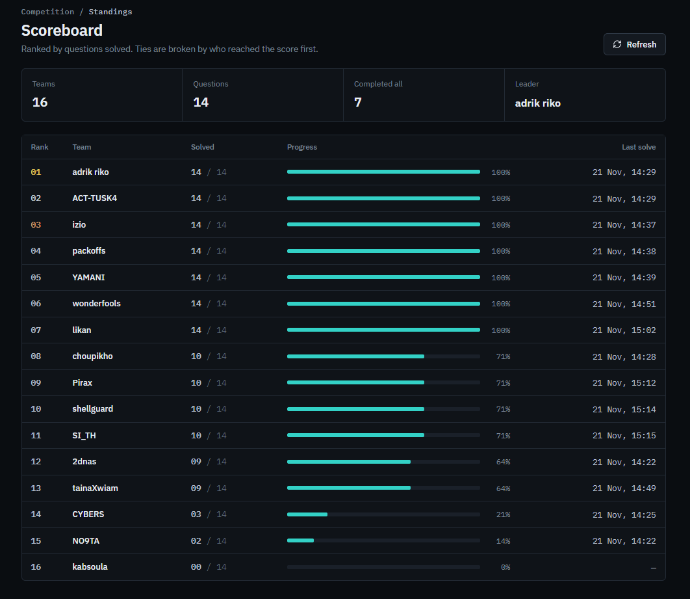

# ENSA TANGER DFIR Workshop 2026

### Digital Forensics — Evidence-Led Windows Investigation

A hands-on **Digital Forensics & Incident Response (DFIR)** session for **ENSA students**, combining essential forensic concepts with a practical Windows CTF investigation.

## 👨‍🏫 Topics Covered

- **Disk acquisition & integrity:** forensic imaging, read-only analysis, and SHA-256 verification.
- **Windows forensic artifacts:** Prefetch, Amcache, LNK files, Jump Lists, Registry hives, browser traces, and Windows Event Logs.
- **Deleted files & recovery:** NTFS artifacts (`$MFT`, `$UsnJrnl`, `$LogFile`), Recycle Bin, and recovery limitations.
- **Timeline reconstruction:** correlating evidence from different sources to understand an incident.
- **Forensic methodology:** preserving evidence, validating findings, and distinguishing facts from assumptions.

## 🕵️ Practical Workshop: Cyberspace Invoice CTF

Students investigated a simulated Windows compromise using a phishing email (`.eml`) and an **AccessData logical image (`.ad1`)**. The hands-on challenge involved:

1. Identifying the phishing email and document-delivery link.
2. Analyzing a malicious Word VBA macro and its attempted file collection and HTTP exfiltration.
3. Investigating credential files, successful **SSH** access, and reconnaissance commands.
4. Correlating **Windows Security** and **PowerShell Operational** logs to trace script download and execution.
5. Recovering a hidden flag through **offline XOR decoding**.

The goal was to explain **what happened, when it happened, and which artifact supports each finding** — without executing malicious code.

## 🏆 CTF Scoreboard

A look at the final scoreboard from our ENSA DFIR
workshop. Congratulations to everyone who participated
and successfully completed the challenges!

## 👩‍💻 Tools Used

| Tool | Purpose |
| --- | --- |
| [FTK Imager](https://www.exterro.com/ftk-imager) | Explore and export evidence from the AD1 image |
| [Eric Zimmerman's Tools](https://ericzimmerman.github.io/) | Analyze Windows forensic artifacts and reconstruct event timelines |
| [oletools](https://github.com/decalage2/oletools) | Examine VBA macros statically |
| [Python 3](https://www.python.org/downloads/) | Analyze artifacts and decode the flag |

## 🧑‍🎓 Repository Content

- [**CTF writeup**](./writeup.md) — investigation methodology, forensic evidence, and challenge solutions.

---

**Prepared for ENSA students · 2026 · Mr_Togoo**
